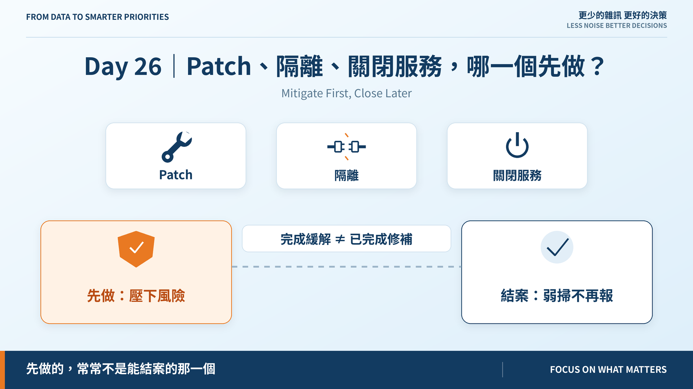
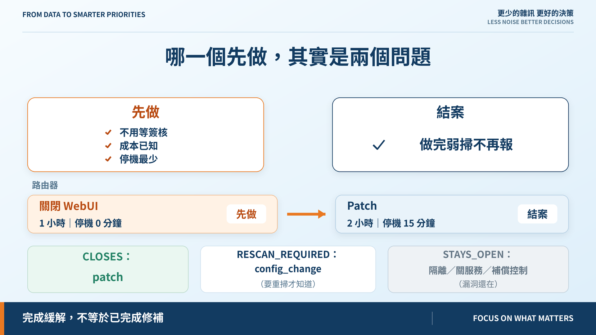
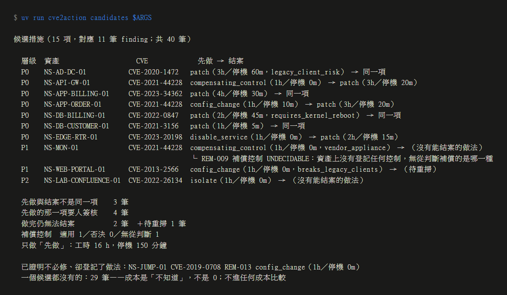

# Day 26｜Patch、隔離、關閉服務，哪一個先做？

**Mitigate First, Close Later**

> **施工進度｜** 定邊界（Day 1–5）→ 接資料（Day 6–10）→ 做評分（11–18）→ 畫攻擊路徑（19–24）→ **給修補建議（25–30）**

先更正 Day 25 的兩處。

**「四台機器、三種做法」**：有兩個以上選項的確實是 4 台，但每台各只有 **2 個**。三種指的是標題那三類，不是每台都有三條路。

**「P0 從 9 變 25」錯了，是 24（60%）。** 報表把「證明不必修」那筆的層級變空白也算成升級，25 是加出來的，不是數出來的。結論不變（32/40 在 KEV，輸入飽和），但**已發表的數字沒有測試守著，就會悄悄是錯的**。已補測試。

## 「哪一個先做」其實是兩個問題

| 問題 | 選的是 |
|---|---|
| **先做** | 不用等簽核、成本已知、停機最少的那一項 |
| **結案** | 做完弱掃不再報的那一項 |

路由器：關掉 WebUI，1 小時、零停機，先做；patch 要 2 小時、停機 15 分鐘，排窗口，**做完才算結案**。

只給一個「建議措施」，WebUI 關掉那天就會被當成結案。藍圖早寫了：

> **完成緩解，不等於已完成修補。**

## 做完之後，三種結局

| 結局 | 動作 | 為什麼 |
|---|---|---|
| `CLOSES` | patch | 版本變了 |
| `RESCAN_REQUIRED` | config_change | 版本沒變，要重掃才知道 |
| `STAYS_OPEN` | 隔離、關服務、補償控制 | 漏洞還在，只是走不到 |

config_change 為什麼是第三態？停用 RC4，finding 會消失；啟用 NLA，BlueKeep 還在。**同一種動作，結局由重掃決定，不由動作類型決定。** 重掃前不算結案。

## 停機 0 分鐘，不等於沒有代價

MOVEit：隔離 2 小時、零停機；patch 4 小時、停機 30 分鐘。只看數字，隔離贏。

但隔離會**斷掉合作夥伴上傳**。有限制就要人簽核，所以引擎先排 patch。

成本讀不到時是 `None`，不是 0，**排最後**。反過來，不知道成本的措施會永遠第一個被選。

## 補償控制要先過番外篇二那道閘

API 閘道的 WAF 對 Log4Shell：攔截點在路徑上、CWE 沒被否決 → **可選**，先做，patch 結案。

監控主機的補償控制：那台**一個控制都沒登記**，不知道補的是哪一種 → 無從判斷。沉默不否決，照列，但不優先。

反例用測試釘住：拿 WAF 當 RC4 的補償控制，會被 CWE-326 **憑證據否決**——WAF 看不到 TLS 層。

## 跑出來

15 項候選、11 筆 finding：

- 先做與結案不同：**3 筆**（路由器、API 閘道、訂單主機）
- 先做那項就要簽核：**4 筆**（DC、帳務 DB、監控、入口網站）
- 做完仍無法結案：**2 筆**，另 1 筆待重掃
- 只做「先做」：16 小時、停機 150 分鐘

## 29 筆一個候選都沒有

其中 **17 筆是 P0**。

最順手的是預設一個 patch。不這麼做：預設 patch 就得預設工時與停機，那是**假裝知道成本**。明天的 ROI 會把編出來的數字當真拿去比。

所以它們標 `NO_CANDIDATE`，不進任何成本比較，照層級留在佇列。

## 還沒做到的

**清冊可能登記錯。** 監控主機那筆動作欄寫補償控制，備註卻是「移除 JndiLookup」——那是 config_change。引擎看不出來。

**工時與停機是兩欄，沒有換算成單一成本，也沒有維護窗口資料。** Day 25 說「一個窗口塞不下」，今天量不出來。

## 明天

「先做」只在同一筆 finding 內比。跨 finding 呢？訂單主機在 16 條路徑上，修它一台值多少？

> **Day 27｜用最少變更切斷最多攻擊路徑**

候選引擎與 ADR：[github.com/oldgi/cve2action](https://github.com/oldgi/cve2action)。Northstar 為虛構；CVE、EPSS、KEV、CWE 為公開資料。
