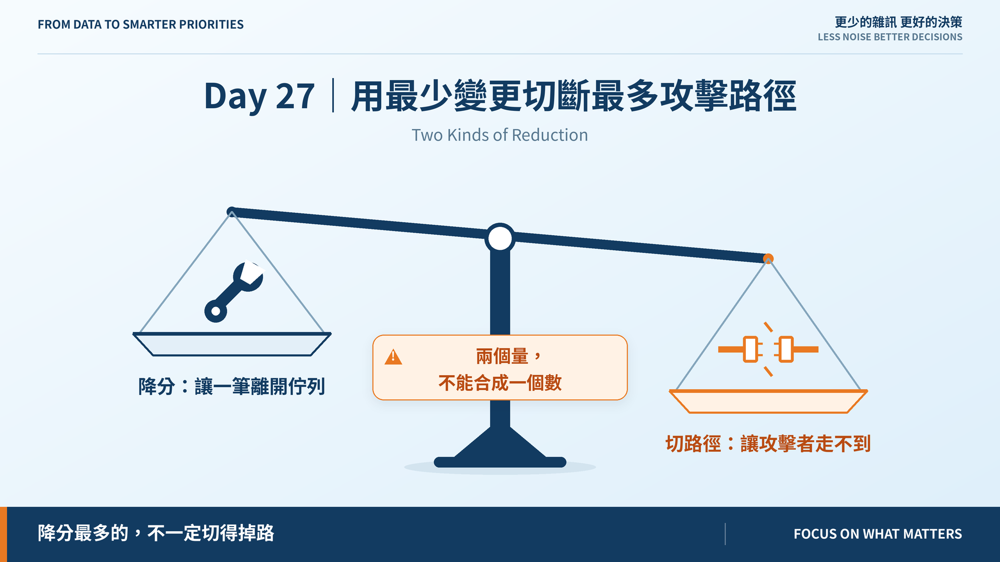
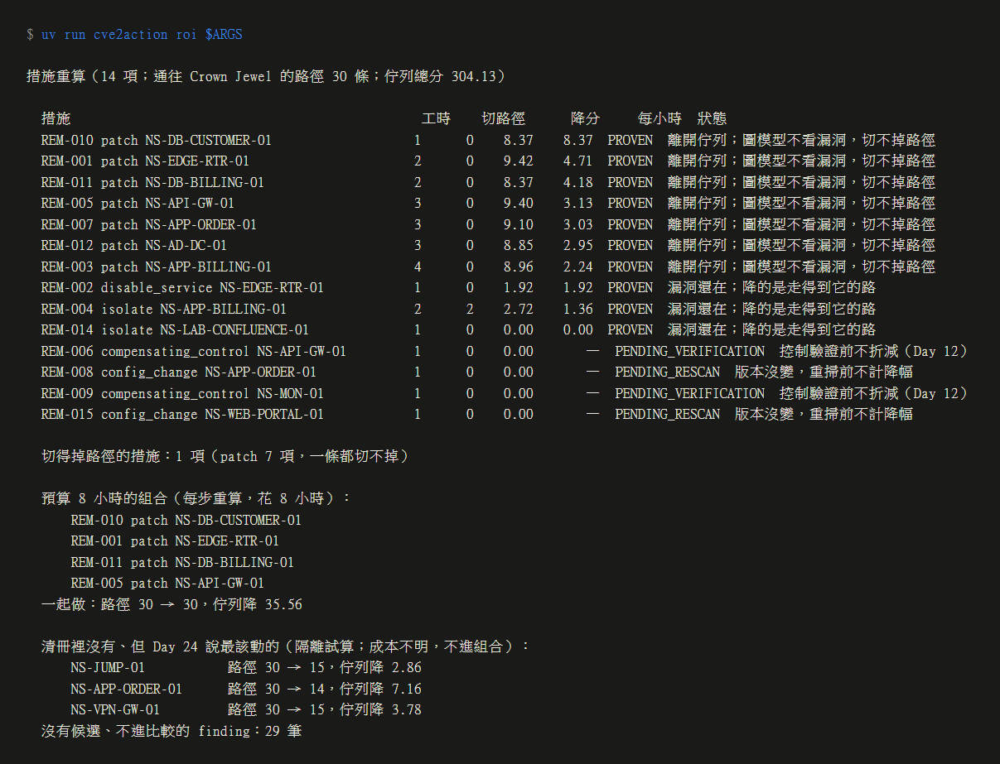

# Day 27｜用最少變更切斷最多攻擊路徑

**Two Kinds of Reduction**

> **施工進度｜** 定邊界（Day 1–5）→ 接資料（Day 6–10）→ 做評分（11–18）→ 畫攻擊路徑（19–24）→ **給修補建議（25–30）**

昨天留的問題：訂單主機在 16 條路徑上，修它值多少？

**看你修的是什麼。** patch 它，佇列降 9.10 分，路徑一條都沒少；隔離它，路徑從 30 剩 14，佇列只降 7.16。同一台機器，兩個答案。

## 降幅要重算，不能估

每一項措施都套到攻擊圖的**複本**上，整條管線重跑：路徑搜尋、路徑分數 A、40 筆重新評分。

| 措施 | 對圖 | 對佇列 |
|---|---|---|
| 隔離 | 拿掉進出的每條邊 | 照圖重算 |
| 關服務 | 拿掉通往該服務的邊 | 照圖重算 |
| patch | 不動 | 這筆離開佇列 |
| 改設定、補償控制 | 不動 | 待重掃／待驗證，**記 0** |

最後一列是昨天的三態延續：沒重掃、沒驗證，就沒有降幅。不知道不能換來第一名。

## patch 切不掉任何一條路徑

14 項措施重算完，**只有 1 項切得掉路徑**：隔離 MOVEit，切 2 條。7 項 patch 全部是 0。

不是 bug。Day 19 的圖把「到得了一個在聽的服務」當成「拿下那台」，**從不看服務上有沒有漏洞**——不知道能不能打，就當能打。代價就是：修掉漏洞，圖一條邊都不少。

要讓 patch 能切路徑，得替每一步登記「憑哪個漏洞」，那會改動 Day 22 已發表的 30 條路徑。今天不改，把後果量出來。

## 兩個量給出相反的答案

| | 切路徑 | 降分 |
|---|---:|---:|
| 隔離跳板（試算） | **15** | 2.86 |
| patch 邊界路由器 | 0 | **9.42** |

降分是**逐筆 finding** 的量：patch 讓一筆整個離開佇列。切路徑是 **Crown Jewel** 的量：跳板自己的分數不高，但它在串聯上。

> **合成一個 ROI，就得定「一條路徑值幾分」的匯率——那個匯率沒有根據。**

所以每小時 ROI 只算降分，切路徑另列一欄，兩個都報。

## 8 小時能做什麼

在預算內每步挑「加進來**重算後**每小時降最多」的那一項——Day 24 說過切斷數不可相加，所以每加一項都重跑。

結果是四個 patch：佇列降 35.56，**路徑 30 → 30**。

還有一筆值得看：隔離實驗室 Confluence，佇列降 **0.00**。它本來就走不到——CVSS 9.8，但隔離它什麼都沒買到。

## 清冊是照弱點登記的

Day 24 說最該動的三台，隔離試算：

| 資產 | 路徑 |
|---|---|
| 跳板 | 30 → 15 |
| 訂單主機 | 30 → 14 |
| VPN | 30 → 15 |

**清冊裡這三台沒有任何一項措施。** 成本不知道，所以它們只能試算，不進組合。

「用最少變更切斷最多路徑」在這份清冊上答不了。不是演算法不夠，是**沒人登記過「隔離跳板要幾小時、會斷掉什麼」**——清冊是看著弱掃報告寫的，不是看著攻擊圖寫的。

## 還沒做到的

圖模型不知道哪一步憑哪個漏洞，所以 patch 的路徑效果永遠是 0。這是 v1.0 會帶著走的限制。

## 明天

分數、路徑、措施都算得出來了，但現在只有命令列看得到。

> **Day 28｜做一個主管與工程師都看得懂的儀表板**

ROI 引擎與 ADR：[github.com/oldgi/cve2action](https://github.com/oldgi/cve2action)。Northstar 為虛構；CVE、EPSS、KEV 為公開資料。
