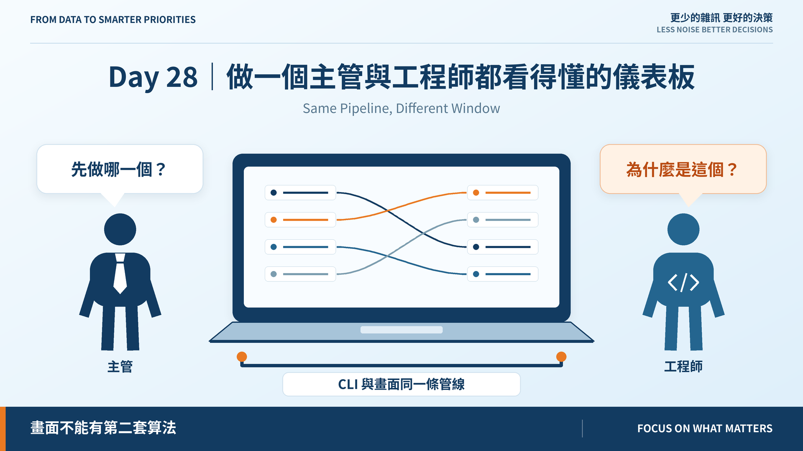
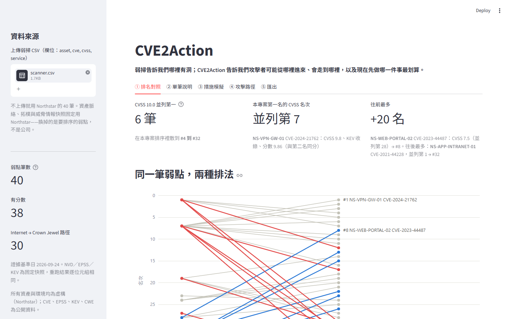
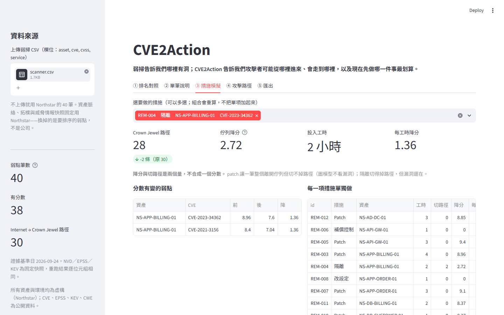

# Day 28｜做一個主管與工程師都看得懂的儀表板

**Same Pipeline, Different Window**



> **施工進度｜** 定邊界（Day 1–5）→ 接資料（Day 6–10）→ 做評分（11–18）→ 畫攻擊路徑（19–24）→ **給修補建議（25–30）**

昨天說：分數、路徑、措施都算得出來，但只有命令列看得到。今天把它們搬上畫面。

## 儀表板不能有第二套算法

最容易出事的地方不是畫圖，是**畫面自己又算了一次**。兩套算法遲早對不上，而讀者看到的是畫面。

所以 `app/data.py` 不自己組評分，它用 CLI 的同一組輸入、呼叫同一批函式。**畫面上的數字與文章、測試、CI 是同一段程式算的。** 測試逐項對：路徑 30、P0 24、隔離 MOVEit 剩 28 條。

## 六個分頁，對應展示腳本八步

藍圖 §14 早就寫好了展示腳本，儀表板照它切：

| 分頁 | 回答 |
|---|---|
| ① 排名對照 | CVSS 說什麼、我們說什麼 |
| ② 單筆說明 | 這一筆為什麼在這裡 |
| ③ 措施模擬 | 做了這件事，會少什麼 |
| ④ 攻擊路徑 | 從哪裡進來、走到哪裡 |
| ⑤ 情境驗證 | 明天的題目 |
| ⑥ 匯出 | 交給誰去做 |

主管看①和③，工程師看②和④。**同一份資料，不同的問題。**

## 兩欄並陳



成功標準 #5：CVSS 排名與本專案排名放在同一個畫面。左邊 CVSS、右邊我們，一條線一筆。

- CVSS 有 **6 筆並列 10.0**，在我們的排序裡散到 **#4 到 #32**
- 我們的第一名，CVSS 是**並列第 7**
- 往前最多的是 HTTP/2 Rapid Reset：CVSS 7.5，**並列第 28 → #8**

注意「並列」。CVSS 同分就是並列——替它們排出先後，等於替 CVSS 編一個它沒有的判斷。同理，我們的第一、二名**同分 9.86**，畫面直接標「同分」。

## 刻意不放的兩樣東西

**P0 筆數不當頭條。** 32/40 在 KEV，覆寫後 24/40 是 P0——輸入飽和時這個數字沒有意義。

**降分與切路徑不合成一個 ROI。** 昨天量到兩者給出相反答案，合成就得定一個沒有根據的匯率。

## 措施模擬



選隔離 MOVEit：路徑 30 → 28、佇列降 2.72、2 小時。多選會**重算組合**，不把單項加起來。

選了改設定或補償控制，畫面直接說「降幅記 0」——沒重掃、沒驗證，就沒有降幅。

## 到期的兩條豁免

Day 23 給評分門檻的兩條豁免寫了 `revisit_on: 2026-10-12`，到期那天 CI 照設計變紅。

當初押的是：「處置模型會讓**一批** finding 以『不必修』離開分母，分布會再變一次。」實測**只有 1 筆**，把它拿掉，最大分級從 0.5263 降到 0.5135，**仍然過半**。

> **預測落空的理由與 Day 18 那次一樣：押在一個還沒做的設計，會怎麼改變一個還沒量的數字。**

根因沒變：B 只有三檔，輸入的解析度決定輸出的解析度。要改就得動值域，Day 5–18 的回歸基準會同時失效。所以重新說明、寫進 v1.0 已知限制，這次**不押任何設計會改善它**。

## 還沒做到的

§14 第 4 步寫「CVSS 8.x 的 KEV 漏洞升到第一」。實測沒有：8.x 的幾筆落在 #14–#30。**儀表板不照劇本演**，它畫資料說的。這是明天要正面回答的事。

## 明天

> **Day 29｜四個情境驗證：模型真的比 CVSS 排序好嗎？**

```bash
uv run --extra dashboard streamlit run app/dashboard.py
```

儀表板與 ADR：[github.com/oldgi/cve2action](https://github.com/oldgi/cve2action)。Northstar 為虛構；CVE、EPSS、KEV 為公開資料。
