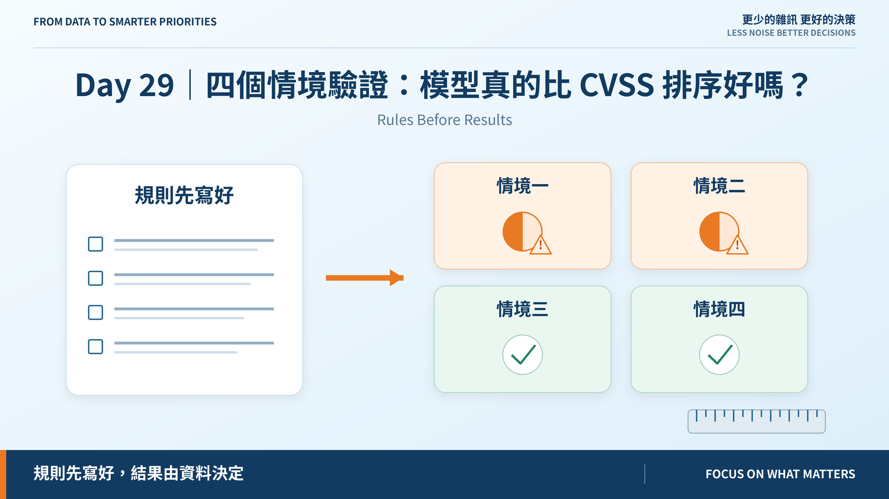
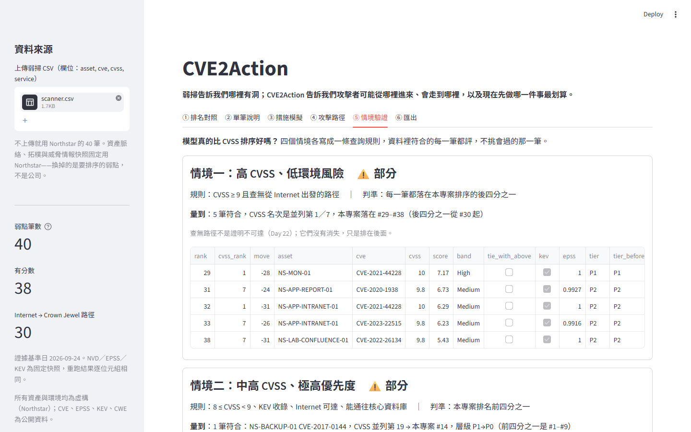

# Day 29｜四個情境驗證：模型真的比 CVSS 排序好嗎？

**Rules Before Results**

> **施工進度｜** 定邊界（Day 1–5）→ 接資料（Day 6–10）→ 做評分（11–18）→ 畫攻擊路徑（19–24）→ **給修補建議（25–30）**

昨天發現展示腳本第 4 步——「CVSS 8.x 的 KEV 漏洞升到第一」——在資料上不成立。今天正面回答。

## 規則先於結果

驗證最容易作弊的地方，是**挑一筆會過的來展示**。所以四個情境各寫成一條查詢規則，逐字對應藍圖 §8.4，資料裡符合的**每一筆**都評：

| 情境 | 規則 | 判準 |
|---|---|---|
| 一 | CVSS ≥ 9、查無路徑 | 落在後四分之一 |
| 二 | CVSS 8.x、KEV、可達、通往核心 DB | 進前四分之一 |
| 三 | 同 CVE、同區域，一台有控制 | 有控制的排後面 |
| 四 | 關一條連線或隔離一台 | 切 ≥ 2 條路徑 |

沒有符合規則的情況記 `NO_CASE`，**不算通過**。

## 結果：兩過、兩部分

**情境三最乾淨。** 兩台入口網站同區域、同角色、同一個 Apache 漏洞，差別只有一台有驗證過的 WAF：有的 **#16**，沒有的 **#3**。這是資料裡自帶的對照實驗，CVSS 給兩台一模一樣的分數。

**情境四過，但要打折。** 關掉跳板的 RDP，30 條路徑剩 15。可是清冊裡沒登記這件事；藍圖原文寫「修補跳板」，在這個圖模型裡切 0 條——Day 27 講過，圖不看漏洞。

**情境一差一名。** 五筆裡四筆落在 #30 之後，監控主機的 Log4Shell 在 **#29**。線是事先畫的，**不事後挪**——挪一名就過，正是不能挪的理由。

**情境二沒到。** 只有一筆符合：備份主機的 EternalBlue，CVSS 並列第 19，我們排 **#14**。往前了，但離前四分之一（#9）還遠。

## 情境二為什麼上不去

輸在 S（8.8 對 9.8）和 E（DATA 區不面對 Internet）。能補回來的 B 和 T，**在頂端全員滿分**——前十名全是 CRITICAL、全在 KEV。

> **一個因子對所有人都一樣，它就沒有在排序。**

它確實升到了 P0，但那是 §9.6 覆寫給的，而覆寫後 24/40 都是 P0。在這份資料上，P0 不構成「極高」。

## 對照人工排序

| 排序 | Kendall τ-b |
|---|---:|
| 本專案 | 0.6 |
| 只看 CVSS | 0.527 |

多對一組。但只有 5 筆，**排序者就是我**——這是自我一致性檢查，不是證據。

另外修正一個用詞：Day 17 的「tau-b」實際算的是丟掉平手的版本，沒有平手時兩者相等。CVSS 有平手，這裡改用真正的 τ-b，平手照定義進分母。

## 差異逐筆說明

成功標準 #5 要「同時呈現」，Day 29 的驗收要「差異逐筆說明」。38 筆，每筆的主因都**算出來**：方向與移動一致、偏離全體中位數最多的那一項。

移動 5 名以上的 26 筆裡，主因是 A 路徑往後 8 筆、E 曝險往前 7 筆、A 往前 5 筆、B 業務往後 3 筆。**拉開 CVSS 的，是「走不走得到」和「面不面對 Internet」。**

## 所以，比較好嗎？

能誠實說的是：**它說的是不同的事，而且每一處不同都說得出理由。** 四個情境裡兩個做到藍圖要的，兩個方向對但力道不夠——缺的不是公式，是輸入的鑑別力。

說「比較好」需要獨立的人工排序。這份專案沒有。

## 明天

> **Day 30｜從 CVE 堆到修補優先序**

報告：`docs/releases/day-29-scenario-report.md`；[github.com/oldgi/cve2action](https://github.com/oldgi/cve2action)。Northstar 為虛構；CVE、EPSS、KEV 為公開資料。
