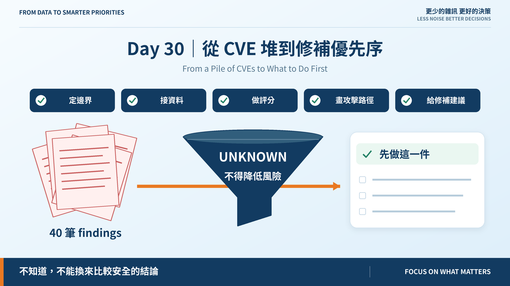
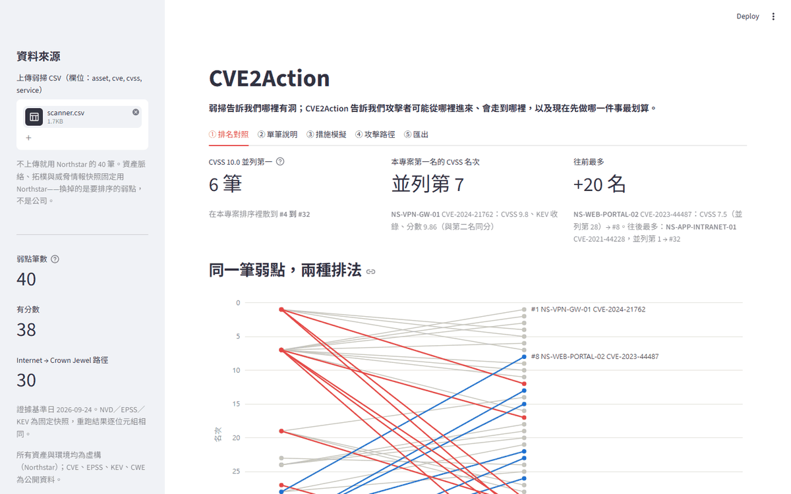

# Day 30｜從 CVE 堆到修補優先序

**From a Pile of CVEs to What to Do First**



> **施工進度｜** 定邊界（Day 1–5）→ 接資料（Day 6–10）→ 做評分（11–18）→ 畫攻擊路徑（19–24）→ **給修補建議（25–30）** ✅

Day 1 的場景：季度弱掃結束，報告很厚，兩週後開會，答案是「項目太多，不知道該從哪裡開始」。

三十天後，同一份弱掃檔丟進去，得到的是這個：



## 一個指令，六個畫面

```bash
docker build -t cve2action .
docker run --rm -p 8501:8501 cve2action
```

全部離線。NVD、EPSS、KEV 是帶日期的固定快照，重跑結果逐位元組相同。

| 畫面 | 回答 |
|---|---|
| 排名對照 | CVSS 的六筆 10.0，在我們的排序裡散到 #4 到 #32 |
| 單筆說明 | 每個分數的公式、來源、與上一名逐項比較 |
| 措施模擬 | 做了這件事，分數降多少、路徑少幾條、花幾小時 |
| 攻擊路徑 | 從 Internet 到 Crown Jewel 的 30 條路與共同瓶頸 |
| 情境驗證 | 四個必測情境，兩過兩部分 |
| 匯出 | 交給維運團隊的優先清單 |

**儀表板沒有自己的算法。** 它呼叫命令列的同一批函式，畫面上的每個數字都等於文章引用的那一個。

## 三十天只講了一件事

> **不知道，不能換來比較安全的結論。**

證據過期的控制是 `UNKNOWN`，不是 `NONE`。沒有威脅資料就移除該項，不補零。查無路徑取下限 0.05，不取 0。空的 CPE 清單不是證據。成本讀不到是 `None`，不是免費。

每一條都在擋同一件事：**讓「沒查」看起來像「查過、沒事」。**

## 錯過的地方

說好要誠實，這裡列三個：

- **Day 25 的 P0 是 24，不是 25。** 報表把「離開佇列」算成「升級」，25 是加出來的。Day 26 更正。
- **評分門檻的豁免預測錯了兩次。** Day 18 押可達性會讓分數變寬，Day 23 押處置模型會讓一批 finding 離開分母。都沒發生。
- **藍圖的展示劇本在資料上不成立。** 「CVSS 8.x 的 KEV 漏洞升到第一」——實測 #14。

每一個都是**量了才知道**。沒量，它們會一直是對的。

## 帶著走的限制

1. 攻擊圖不看漏洞，所以 patch 切不掉路徑
2. 頂端沒有鑑別力：前十名業務衝擊全滿、全在 KEV
3. 兩條評分門檻未過，根因是輸入解析度
4. 29/40 筆沒有任何處置方案
5. 人工基準只有 5 筆，排序者是我
6. 只標完全同分，沒有「分不出來」這個答案

它們不是待辦，是 v1.0 的邊界。寫下來，下一個人才知道從哪裡接。

## 回顧：如果再給三十天

**最錯的假設**：以為 KEV 會是強訊號。32/40 都在 KEV，它在這份資料上幾乎沒有鑑別力。教學資料集挑了有名的 CVE，有名的 CVE 都在 KEV。

**最大的改善**：Day 24 把瓶頸從「出現幾次」改成「拿掉之後還剩幾條」。兩種算法的第一名不同，而只有後者答得出「修這台值多少」。

**最值得做的**：處置清冊。現在它是照弱掃報告寫的；Day 24 說最該動的三台，清冊裡一項措施都沒有。**下一步不是更好的公式，是有人去登記「隔離跳板要幾小時、會斷掉什麼」。**

## 最後

> **弱掃告訴我們哪裡有洞；CVE2Action 告訴我們攻擊者可能從哪裡進來、會走到哪裡，以及現在先做哪一件事最划算。**

謝謝一路看到這裡的你。

程式、30 篇正文與 2 篇番外、25 份 ADR 與 v1.0 release notes：[github.com/oldgi/cve2action](https://github.com/oldgi/cve2action)。Northstar 為虛構；CVE、EPSS、KEV、CWE 為公開資料。
